<div align="center">


# Verdict

**Is your skincare working, or are you just hoping?**

A measured, honest trial of one for any skincare product, built on YouCam AI Skin Analysis.<br>
It ends with a decision you can act on at the till: keep buying it, stop, or wait until a named date.

[](https://github.com/opeblow/verdict/actions/workflows/ci.yml)
[](https://github.com/opeblow/verdict/actions/workflows/codeql.yml)
[](docs/TESTING.md#unit-tests-vitest)
[](docs/TESTING.md#browser-tests-playwright)
[](tests/e2e/a11y.spec.ts)
[](tsconfig.json)
[](LICENSE)

<!-- Before submitting, add: [Live demo](https://your-deployment) / [Demo video](https://youtu.be/...) / -->
[For judges](#for-judges) &nbsp;/&nbsp; [How it decides](docs/METHOD.md) &nbsp;/&nbsp; [Architecture](docs/ARCHITECTURE.md) &nbsp;/&nbsp; [Decisions](docs/adr/README.md) &nbsp;/&nbsp; [Setup](docs/SETUP.md)

[](https://vercel.com/new/clone?repository-url=https%3A%2F%2Fgithub.com%2Fopeblow%2Fverdict&env=YOUCAM_API_KEY&envDescription=Your%20YouCam%20API%20key.%20Add%20ACCESS_CODE%20later%20to%20protect%20a%20public%20demo&envLink=https%3A%2F%2Fgithub.com%2Fopeblow%2Fverdict%2Fblob%2Fmain%2Fdocs%2FSETUP.md&project-name=verdict&repository-name=verdict)

</div>

---

<p align="center">
  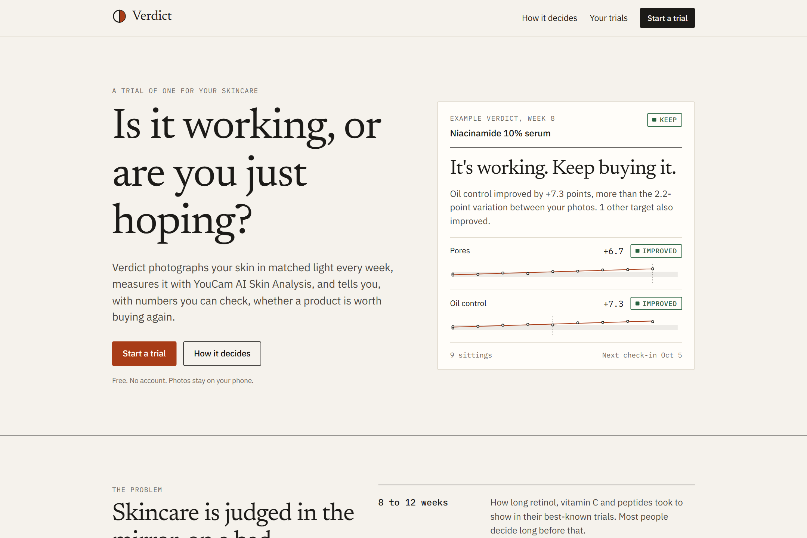
</p>

## Contents

- [At a glance](#at-a-glance)
- [For judges](#for-judges)
- [The problem](#the-problem)
- [What Verdict does](#what-verdict-does)
- [How YouCam is used](#how-youcam-is-used)
- [How a verdict is computed](#how-a-verdict-is-computed)
- [Engineering](#engineering)
- [Quickstart](#quickstart)
- [Documentation](#documentation)
- [Limits](#limits)
- [Roadmap](#roadmap)

## At a glance

| | |
|---|---|
| **Who it is for** | Anyone who has bought a skincare product and wondered, weeks later, whether to buy it again |
| **The moment it meets** | The brief's own words: "standing in front of a mirror deciding whether a product is working" |
| **What you get** | Keep, Stop, Wait (with a date), More data, Likely purging, or Don't rebuy, each with the numbers behind it |
| **How YouCam is used** | As a measuring instrument across weeks: the full upload, analyse, poll, mask and delete cycle, HD and SD, up to 8 concerns per call |
| **What makes it trustworthy** | `raw_score` only, a measured personal noise floor, 95% ranges, matched light, and "too early" as a real answer |
| **Privacy** | No accounts and no server database. Photos and scores live on your device. Photos are deleted from YouCam once results are saved. |
| **Engineering** | Next.js 16, React 19, strict TypeScript, 108 unit tests, 25 browser tests, axe accessibility checks, eight decision records, CI, CodeQL, strict CSP |
| **Track** | Skin AI |

## For judges

The four criteria are weighted equally. Every claim below links to the code, test or document that proves it.

### 1. Technological implementation

| What Verdict does | Evidence |
|---|---|
| The full YouCam v2 cycle on the server: register file, presigned `PUT`, create task, poll, collect masks, delete the task | [`youcam.ts`](src/lib/server/youcam.ts), [YOUCAM.md](docs/YOUCAM.md) |
| HD and SD, chosen at baseline and locked for the trial so incomparable scores are never mixed | [ADR 0003](docs/adr/0003-one-analysis-mode-per-trial.md) |
| Concern sets filled to the edge of YouCam's billing tier, so no paid capacity is wasted | [ADR 0007](docs/adr/0007-concern-sets-fill-the-billing-tier.md) |
| `raw_score` for every calculation, because YouCam documents `ui_score` as adjusted upwards | [ADR 0002](docs/adr/0002-raw-score-not-ui-score.md) |
| The live engine error format, `"('message', 'error_code')"`, parsed into plain instructions such as "Move closer" | [`errors.ts`](src/lib/youcam/errors.ts) |
| Photos deleted from YouCam only after results are safely on the device, with a free retry if saving fails | [ADR 0006](docs/adr/0006-delete-from-youcam-after-local-save.md) |
| A dependency-free statistics engine: noise with a cautious prior, least-squares trend, pooled 95% interval | [`stats.ts`](src/lib/domain/stats.ts), [ADR 0004](docs/adr/0004-change-must-clear-measured-noise.md) |
| 108 unit tests and 25 browser tests in CI, with YouCam mocked so no units are spent | [TESTING.md](docs/TESTING.md), [`ci.yml`](.github/workflows/ci.yml) |

### 2. Design

| What Verdict does | Evidence |
|---|---|
| A complete journey: choose product, set goals, two baseline photos, weekly check-ins, dashboard, verdict | [Screenshots](#what-verdict-does), [`trial-journey.spec.ts`](tests/e2e/trial-journey.spec.ts) |
| Guided capture: your first photo is overlaid on the camera, with a live readout of brightness, side light, colour temperature, glare and blur | [`CaptureFlow.tsx`](src/components/capture/CaptureFlow.tsx), [`quality.ts`](src/lib/capture/quality.ts) |
| Product search, barcode scanning and manual entry, with ingredients read automatically | [`ProductPicker.tsx`](src/components/product/ProductPicker.tsx) |
| Cost per week and per year next to the verdict, so the answer is about money as well as skin | [`TrialDashboard.tsx`](src/app/trials/[id]/TrialDashboard.tsx) |
| A distinctive editorial design system with light and dark themes, phone first, checked against WCAG 2.2 AA in both themes | [`globals.css`](src/app/globals.css), [`a11y.spec.ts`](tests/e2e/a11y.spec.ts) |

### 3. Potential impact

| What Verdict does | Evidence |
|---|---|
| Meets a decision every skincare buyer makes, repeatedly: buy it again or not | [The problem](#the-problem) |
| Stops people abandoning good products too early, by giving each active a fair-verdict week (niacinamide on pores: about eight weeks) | [`ingredients.ts`](src/lib/domain/ingredients.ts), 18 actives |
| Catches irritation early: redness is measured on every photo, whatever the product claims, and a rise stops the trial | [`concerns.ts`](src/lib/domain/concerns.ts), [`verdict.test.ts`](tests/unit/verdict.test.ts) |
| Value for shoppers (money not wasted) and for retailers (fewer returns, confident repeat purchases of products that work) | [Roadmap](#roadmap) |
| Ready to run: one-click deploy, guarded API units, no database to operate | [SETUP.md](docs/SETUP.md#6-deploy) |

### 4. Quality of the idea

| What Verdict does | Evidence |
|---|---|
| Uses YouCam as a measuring instrument across time. One score is a curiosity; a series with known noise is evidence. | [METHOD.md](docs/METHOD.md) |
| Two baseline photos a minute apart measure each person's own noise floor, and every claim of change must clear it | [ADR 0004](docs/adr/0004-change-must-clear-measured-noise.md) |
| Tells a purge from a reaction: blemishes rising early on a retinoid or acid are likely purging; rising redness means stop | [`verdict.ts`](src/lib/domain/verdict.ts) |
| Compares each person only with themselves, in their own light, instead of with population norms that may fit some skin tones poorly | [Limits](#limits) |

### Test it in five minutes

**On the live app** (needs a camera and good front light):

1. Open the live app. If asked, enter the access code from the submission form.
2. Choose **Start a trial**, then **Enter by hand**. Paste `Aqua, Niacinamide, Zinc PCA, Glycerin` as the ingredients.
3. Accept the suggested targets. Note the fair-verdict week Verdict sets for each one.
4. Take the two baseline photos. Each takes 10 to 40 seconds to analyse.
5. Open the trial and choose **Check in now** to see the alignment overlay and light matching against your first photo.

A real trial takes weeks, so the landing page shows the real engine's output on a clearly labelled example trial, and the demo video shows completed trials.

**Without a key or camera**, every rule and the whole journey can be checked from the code:

```bash
git clone https://github.com/opeblow/verdict.git && cd verdict
npm install
npm test                                    # 108 unit tests, including every verdict rule
npm run build && npx playwright install chromium
npm run test:e2e                            # 25 browser tests, YouCam mocked
```

## The problem

People do not wonder about their skin in the abstract. They wonder in front of the mirror, three weeks into a new serum, deciding whether to buy another bottle. That moment fails them in three ways:

1. **They judge too early.** Retinol, vitamin C and peptides took 8 to 12 weeks to show in their best-known trials. One renewal cycle of the skin's outer layer is about four weeks. Most people decide long before either.
2. **They judge against noise.** The same skin photographed in a brighter room, or under a warmer lamp, looks different. A mirror cannot separate real change from changed light.
3. **They cannot tell a purge from a reaction.** More blemishes in week two of a retinoid is common and expected. Rising redness is a reason to stop. Both feel like "it's not working".

The result is money spent on products that do nothing, good products abandoned too soon, and irritants kept too long.

## What Verdict does

| Step | What happens |
|---|---|
| **1. Name the product** | Search Open Beauty Facts, scan the barcode, or type it in. Verdict reads the ingredient list, finds the actives, and sets a fair-verdict week for each claim. |
| **2. Two baseline photos** | Taken a minute apart. Their difference measures how much your scores move when nothing has changed: your personal noise floor. |
| **3. Weekly check-ins** | Your first photo is overlaid on the camera so you line up the same way. Light is measured and compared with the first photo before a new one counts. |
| **4. A verdict** | Keep, stop, wait until a named date, likely purging, or don't rebuy. Every claim of change is larger than your measured noise floor. |

<table>
  <tr>
    <td width="33%">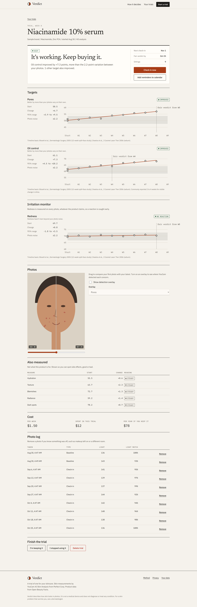</td>
    <td width="33%">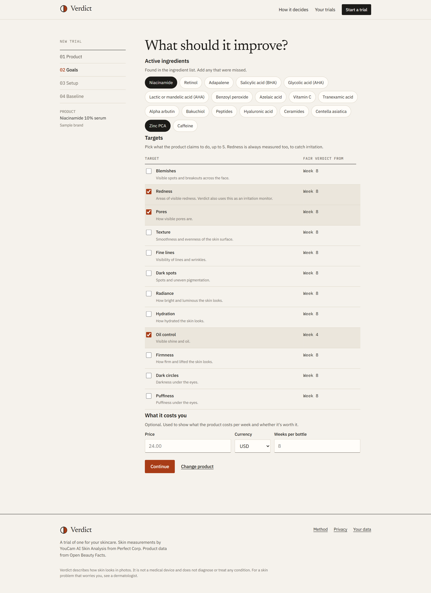</td>
    <td width="33%">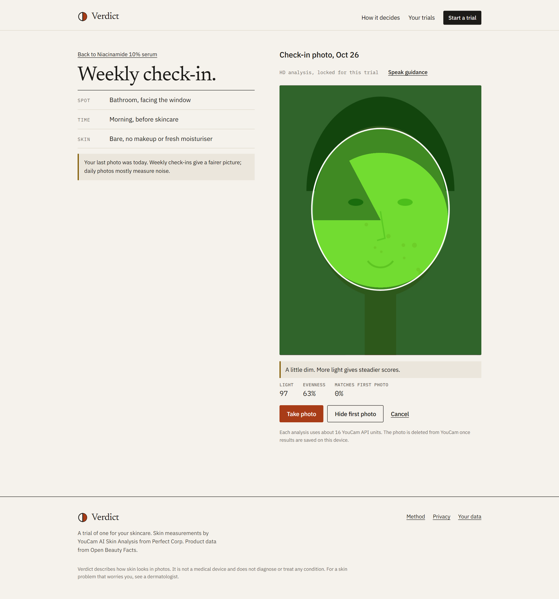</td>
  </tr>
  <tr>
    <td align="center"><sub><b>Verdict and evidence</b><br>change, 95% range, photo noise, fair-verdict week</sub></td>
    <td align="center"><sub><b>Goals from ingredients</b><br>slowest active sets the deadline</sub></td>
    <td align="center"><sub><b>Matched capture</b><br>light is checked against the first photo</sub></td>
  </tr>
  <tr>
    <td width="33%">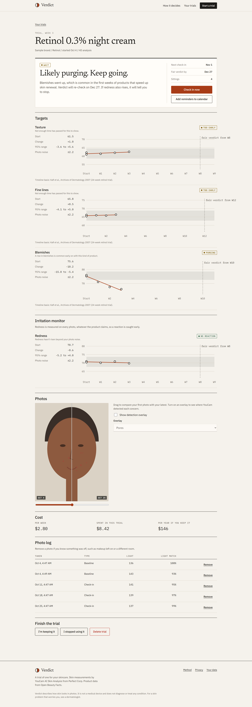</td>
    <td width="33%">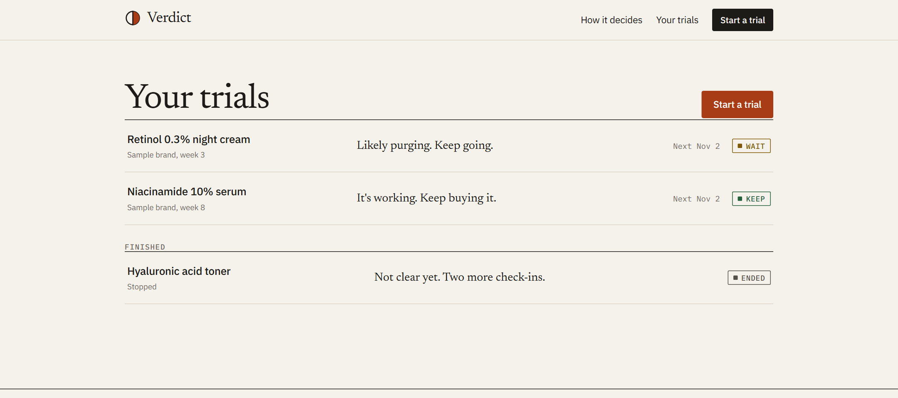</td>
    <td width="33%">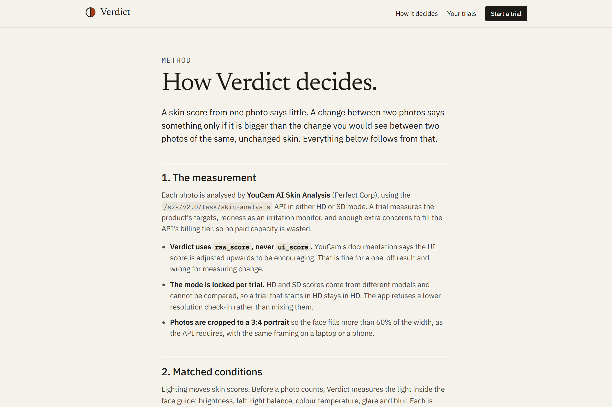</td>
  </tr>
  <tr>
    <td align="center"><sub><b>Purge, not reaction</b><br>blemishes up early, redness flat</sub></td>
    <td align="center"><sub><b>Your trials</b></sub></td>
    <td align="center"><sub><b>Published method</b></sub></td>
  </tr>
  <tr>
    <td width="33%">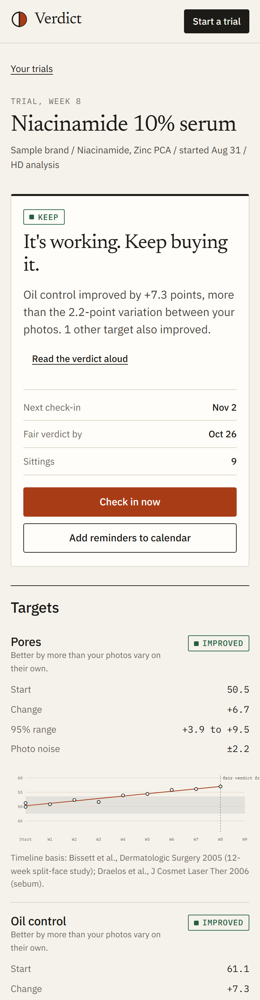</td>
    <td width="33%">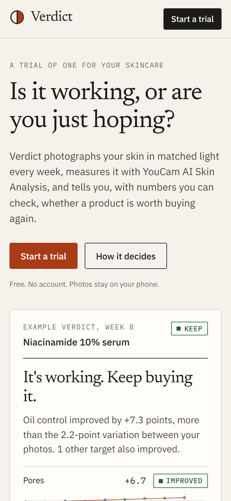</td>
    <td width="33%">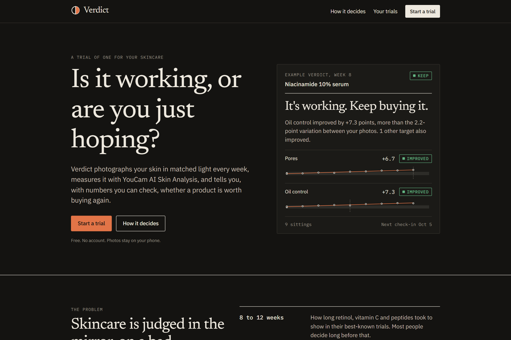</td>
  </tr>
  <tr>
    <td align="center"><sub><b>Phone first</b></sub></td>
    <td align="center"><sub><b>Landing on a phone</b></sub></td>
    <td align="center"><sub><b>Dark theme</b></sub></td>
  </tr>
</table>

## How YouCam is used

Every call is made from the server; the key never reaches the browser.

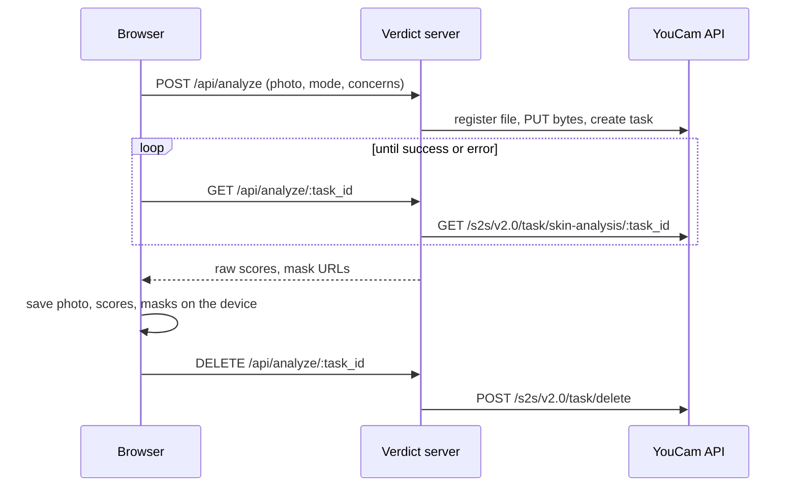

Twelve concerns, HD and SD, regional HD scores, billing-tier planning, the live error format and the unit budget are covered in [docs/YOUCAM.md](docs/YOUCAM.md).

## How a verdict is computed

1. **Noise floor.** Replicate photos estimate per-photo noise, shrunk towards a cautious prior so two lucky photos cannot create false confidence.
2. **Change.** A least-squares line through every photo since day zero, with a 95% interval that pools replicate noise and scatter around the line.
3. **Decision.** Improved or worse only when the whole interval clears zero and the change is at least 3 points. "Don't rebuy" only when a meaningful benefit is ruled out. Before an active's fair-verdict week, the answer is "wait", with the date.
4. **Domain rules.** Blemishes rising early on a retinoid or exfoliating acid are labelled likely purging. Redness rising beyond the noise floor stops the trial at any week.

| Decision | Shown when |
|---|---|
| **Wait** | It is before the fair-verdict week of the slowest target. The date is shown. |
| **More data** | The fair-verdict week has passed but the 95% range is still too wide to call. |
| **Keep** | A target improved: the whole 95% range is above zero and the change is at least 3 points. |
| **Stop** | Redness rose beyond the noise floor, at any week. This overrides every other result. |
| **Don't rebuy** | A meaningful benefit is ruled out on the targets. |

Full write-up: [docs/METHOD.md](docs/METHOD.md).

## Engineering

| Area | What is in place |
|---|---|
| **Architecture** | One Next.js app. Personal data in the browser's IndexedDB; a stateless server holds the key. Pure domain layer with no I/O. [ARCHITECTURE.md](docs/ARCHITECTURE.md) |
| **Decisions** | Eight architecture decision records, each naming the code and tests that enforce it. [docs/adr](docs/adr/README.md) |
| **Tests** | 108 unit tests (Vitest) and 25 browser tests (Playwright) on desktop and phone, including a full trial, a failed-save retry and API guards. [TESTING.md](docs/TESTING.md) |
| **Accessibility** | axe finds no WCAG 2.2 A or AA violations on six pages in light and dark themes; the wizard works by keyboard alone; charts have text summaries; status changes are announced |
| **Security** | Strict Content Security Policy, SSRF allow-list on the mask proxy, Zod validation, constant-time access code, rate limits, CodeQL. [SECURITY.md](SECURITY.md) |
| **Privacy** | No accounts, no server database, no request logging; export, import and erase. [PRIVACY.md](docs/PRIVACY.md) |
| **Honest copy** | A test fails the build on medical claims or emoji in user-facing text. [`copy-guard.test.ts`](tests/unit/copy-guard.test.ts) |
| **Automation** | CI runs lint, strict typecheck, unit tests with coverage, a production build and the browser suite on every push. Dependabot keeps dependencies current. |

```
src/
  app/          pages and API routes (analyze, mask, products, health)
  components/   capture, product picker, verdict card, charts, compare slider
  lib/
    domain/     concerns, ingredients, statistics, verdict rules (pure)
    capture/    light and framing checks, photo preparation
    client/     IndexedDB, API calls, calendar export
    server/     YouCam client, env, guards, rate limits
    youcam/     response normalisation and error mapping
tests/
  unit/         Vitest suites
  e2e/          Playwright suites and helpers
docs/           method, architecture, decision records, API, setup, testing
```

## Quickstart

Requires Node 20.9 or newer and a YouCam API key. Full instructions: [docs/SETUP.md](docs/SETUP.md).

```bash
git clone https://github.com/opeblow/verdict.git
cd verdict
npm install
cp .env.example .env.local      # add YOUCAM_API_KEY
npm run dev                     # http://localhost:3000
```

| Command | Does |
|---|---|
| `npm run dev` | Development server |
| `npm run build` then `npm start` | Production build and server |
| `npm run check` | Lint, strict typecheck and unit tests, as CI runs them |
| `npm run test:e2e` | Browser tests against the production build, YouCam mocked |
| `npm run smoke:youcam -- photo.jpg sd` | One live analysis with your key (costs 9 units) |
| `npm run screenshots` | Regenerate the images in this README |

## Documentation

| Document | Contents |
|---|---|
| [docs/METHOD.md](docs/METHOD.md) | The measurement protocol and statistics |
| [docs/YOUCAM.md](docs/YOUCAM.md) | The YouCam integration in detail |
| [docs/ARCHITECTURE.md](docs/ARCHITECTURE.md) | System, layers, data model, repository layout |
| [docs/adr/](docs/adr/README.md) | Architecture decision records |
| [docs/API.md](docs/API.md) | HTTP routes and error codes |
| [docs/TESTING.md](docs/TESTING.md) | Test suites and how to extend them |
| [docs/SETUP.md](docs/SETUP.md) | Install, configure, deploy, troubleshoot |
| [docs/PRIVACY.md](docs/PRIVACY.md) | Where data goes |
| [SECURITY.md](SECURITY.md) | Threat model and vulnerability reporting |
| [CONTRIBUTING.md](CONTRIBUTING.md) | How to contribute |
| [AGENTS.md](AGENTS.md) | Rules and invariants for contributors and coding agents |

## Limits

Verdict measures how skin looks in photos. It is not a medical device and does not diagnose or treat any condition. A trial of one cannot rule out other causes, such as weather, sleep, or a second new product, so the app asks you to change one thing at a time. Analysis models can be less reliable for some skin tones and in low light. Verdict compares each person only with their own earlier photos, in their own light, which reduces this but does not remove it.

## Roadmap

- **Split-face trials:** product on one side only, compared using the detection masks.
- **YouCam Skin Tone Analysis** as an independent light-matching check.
- **An MCP tool interface** so an assistant can run check-ins in conversation.
- **For retailers:** opt-in, anonymised "how often does this product earn a Keep" on product pages.

## Credits and licence

Skin measurement by [YouCam AI Skin Analysis](https://yce.perfectcorp.com/ai-api) from Perfect Corp, used under the YouCam API terms of service. Product data from [Open Beauty Facts](https://world.openbeautyfacts.org), available under the Open Database License. Typefaces Newsreader and IBM Plex, under the SIL Open Font License.

Verdict is released under the [MIT License](LICENSE).
