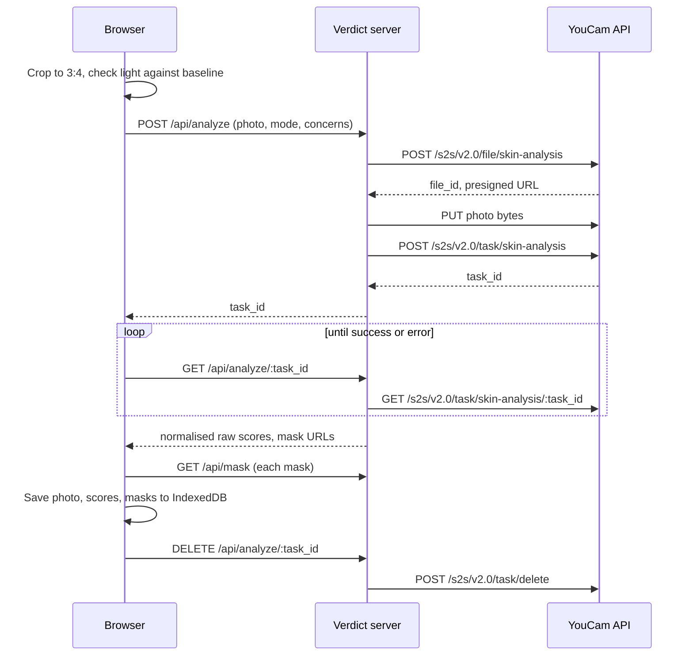
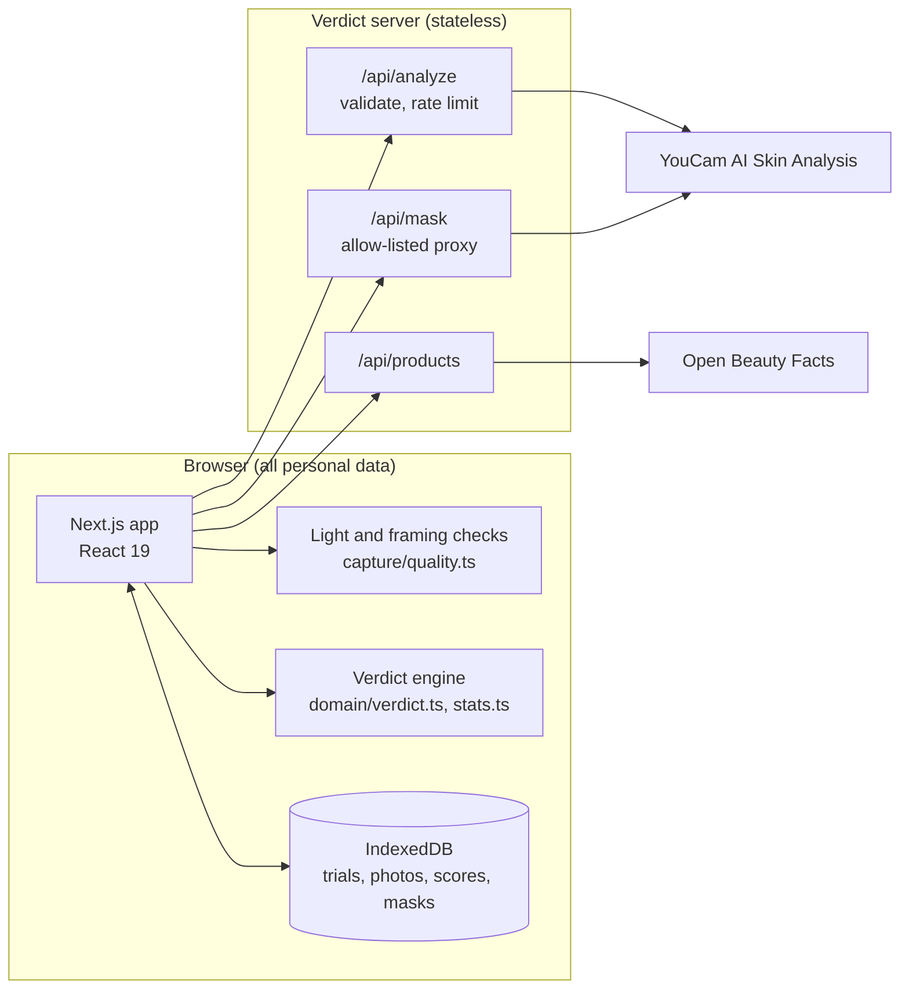

<div align="center">


# Verdict

**Is your skincare working, or are you just hoping?**

A measured, honest trial of one for any skincare product, built on YouCam AI Skin Analysis.

[](https://github.com/opeblow/verdict/actions/workflows/ci.yml)
[](https://github.com/opeblow/verdict/actions/workflows/codeql.yml)
[](LICENSE)
[](package.json)
[](tsconfig.json)
[](tests/)
[](https://yce.perfectcorp.com/ai-api)

[Live demo](https://verdict.example.com) &nbsp;/&nbsp; [Demo video](https://youtu.be/VIDEO_ID) &nbsp;/&nbsp; [How it decides](docs/METHOD.md) &nbsp;/&nbsp; [Setup](SETUP.md)

</div>

---

<p align="center">
  
</p>

## The problem

People do not wonder about their skin in the abstract. They wonder in front of the mirror, three weeks into a new serum, deciding whether to buy another bottle. That moment fails them in three ways:

1. **They judge too early.** Retinol, vitamin C and peptides took 8 to 12 weeks to show in their best-known trials. One renewal cycle of the skin's outer layer is about four weeks. Most people decide long before either.
2. **They judge against noise.** The same skin photographed in a brighter room, or under a warmer lamp, looks different. A mirror cannot separate real change from changed light.
3. **They cannot tell a purge from a reaction.** More blemishes in week two of a retinoid is common and expected. Rising redness is a reason to stop. Both feel like "it's not working".

The result is money spent on products that do nothing, good products abandoned too soon, and irritants kept too long.

## What Verdict does

Verdict turns "is this working?" into a small, fair experiment and gives a decision with a reason.

| Step | What happens |
|---|---|
| **1. Name the product** | Search Open Beauty Facts, scan the barcode, or type it in. Verdict reads the ingredient list, finds the actives, and sets a fair-verdict week for each claim. |
| **2. Two baseline photos** | Taken a minute apart. Their difference measures how much your scores move when nothing has changed: your personal noise floor. |
| **3. Weekly check-ins** | Your first photo is overlaid on the camera so you line up the same way. Brightness, side-light, colour temperature, glare and blur are measured and compared with the first photo before a new one counts. |
| **4. A verdict** | Keep, stop, wait until a named date, likely purging, or don't rebuy. Every claim of change is larger than your measured noise floor. |

<table>
  <tr>
    <td width="33%"></td>
    <td width="33%"></td>
    <td width="33%"></td>
  </tr>
  <tr>
    <td align="center"><sub><b>Verdict and evidence</b><br>change, 95% range, photo noise, fair-verdict week</sub></td>
    <td align="center"><sub><b>Goals from ingredients</b><br>slowest active sets the deadline</sub></td>
    <td align="center"><sub><b>Matched capture</b><br>light is checked against the first photo</sub></td>
  </tr>
  <tr>
    <td width="33%"></td>
    <td width="33%"></td>
    <td width="33%"></td>
  </tr>
  <tr>
    <td align="center"><sub><b>Your trials</b></sub></td>
    <td align="center"><sub><b>Published method</b></sub></td>
    <td align="center"><sub><b>Phone first</b></sub></td>
  </tr>
</table>

## YouCam API integration

Verdict uses **YouCam AI Skin Analysis** (Perfect Corp) as its measuring instrument. All calls are made from the server; the API key never reaches the browser.

| Step | Endpoint | Where |
|---|---|---|
| Register upload | `POST /s2s/v2.0/file/skin-analysis` | [`src/lib/server/youcam.ts`](src/lib/server/youcam.ts) |
| Upload bytes | `PUT` to the presigned URL | same |
| Run analysis | `POST /s2s/v2.0/task/skin-analysis` with `format: "json"` and HD or SD `dst_actions` | same |
| Poll | `GET /s2s/v2.0/task/skin-analysis/{task_id}` | [`src/app/api/analyze/[taskId]/route.ts`](src/app/api/analyze/[taskId]/route.ts) |
| Copy masks to device | Result `mask_urls` through an allow-listed proxy | [`src/app/api/mask/route.ts`](src/app/api/mask/route.ts) |
| Delete from YouCam | `POST /s2s/v2.0/task/delete` | [`src/lib/client/api.ts`](src/lib/client/api.ts) |



### Decisions that make the measurement honest

- **`raw_score`, never `ui_score`.** YouCam's documentation states the UI score is adjusted upwards as a motivator. It is the right number to show once and the wrong number to measure change with.
- **One mode per trial.** HD and SD come from different models. A trial locks to the mode of its first photo and refuses a lower-resolution check-in instead of mixing incomparable scores.
- **Billing-tier aware.** YouCam bills by concern count (1-4, 5-8, 9-12, 13-16). Verdict measures the targets plus a redness irritation monitor, then fills the rest of the tier so no paid capacity is wasted ([`planConcerns`](src/lib/domain/concerns.ts)).
- **Framed for the model.** The API needs the face wider than 60% of the image. Every photo is cropped to a centred 3:4 portrait with a face guide sized to that rule, so a laptop webcam and a phone produce the same framing.
- **Live error format handled.** The live API returns engine errors as a stringified tuple, `"('message', 'error_code')"`, not the bare code the reference shows. Both are parsed and mapped to a plain instruction such as "Move closer" ([`errors.ts`](src/lib/youcam/errors.ts)).
- **Masks survive expiry.** Result links expire after about two hours, so detection masks are copied to the device immediately, then the task is deleted from YouCam.

## How a verdict is computed

Full write-up: [docs/METHOD.md](docs/METHOD.md). In short:

1. **Noise floor.** Replicate photos estimate per-photo measurement noise, shrunk towards a cautious prior so two lucky photos cannot create false confidence.
2. **Change.** A least-squares line through every photo since day zero, with a 95% interval that pools the replicate noise and the scatter around the line.
3. **Decision.** Improved or worse only when the whole interval clears zero and the change is at least 3 points. "Don't rebuy" only when a meaningful benefit is confidently ruled out. Before an active's fair-verdict week the answer is "wait", with the date.
4. **Domain rules.** Blemishes rising in the first six weeks of a retinoid or exfoliating acid are labelled likely purging. Redness rising beyond the noise floor stops the trial at any week.

The engine is pure TypeScript with no dependencies ([`src/lib/domain`](src/lib/domain)) and is covered by unit tests that pin each rule.

## Architecture



- **No database, no accounts.** The server holds no personal data. Everything lives in the browser and can be exported, imported or erased from [Your data](src/app/settings/DataSettings.tsx).
- **Defence in depth.** Strict Content Security Policy, an SSRF allow-list on the mask proxy, input validation with Zod, per-visitor and daily caps on analyses, and an optional access code for public demos. See [SECURITY.md](SECURITY.md).

## Quickstart

Requires Node 20.9 or newer and a YouCam API key. Full instructions: [SETUP.md](SETUP.md).

```bash
git clone https://github.com/opeblow/verdict.git
cd verdict
npm install
cp .env.example .env.local      # add YOUCAM_API_KEY
npm run dev                      # http://localhost:3000
```

The camera needs a secure context: `localhost` works in development; use HTTPS for a phone.

| Command | Does |
|---|---|
| `npm run dev` | Development server |
| `npm run build` and `npm start` | Production build and server |
| `npm run check` | Lint, typecheck and unit tests, as CI runs them |
| `npm run smoke:youcam -- photo.jpg` | One live analysis against your key, printing the normalised result |
| `npm run screenshots` | Regenerate the images in this README |

## Project layout

```
src/
  app/                 routes: landing, trials, check-in, method, privacy, settings, API
  components/          capture flow, product picker, verdict card, charts
  lib/domain/          pure logic: concerns, ingredients, statistics, verdict rules
  lib/youcam/          response normalisation and error mapping (shared)
  lib/server/          YouCam client, env, guards, rate limiting (server only)
  lib/capture/         light measurement and photo preparation
  lib/client/          IndexedDB storage, API calls, calendar export
tests/                 Vitest suites and YouCam response fixtures
docs/                  method, submission notes, screenshots
```

## Testing

```bash
npm test
```

107 tests cover the statistics, every verdict rule, the YouCam client call sequence and error handling, response normalisation for HD and SD, the SSRF guard, rate limiting, light measurement, calendar export, and a copy guard that fails the build on medical claims or emoji in user-facing text.

## Limits

Verdict measures how skin looks in photos. It is not a medical device and does not diagnose or treat any condition. A trial of one cannot rule out other causes, such as weather, sleep, or a second new product, so the app asks you to change one thing at a time. Analysis models can be less reliable for some skin tones and in low light; matching your own conditions week to week reduces this but does not remove it.

## Documentation

| | |
|---|---|
| [SETUP.md](SETUP.md) | Install, configure, deploy |
| [docs/METHOD.md](docs/METHOD.md) | The measurement protocol and statistics |
| [PLANS.md](PLANS.md) | Research, product decisions and roadmap |
| [AGENTS.md](AGENTS.md) | Guide for AI coding agents working in this repo |
| [CONTRIBUTING.md](CONTRIBUTING.md) | How to contribute |
| [SECURITY.md](SECURITY.md) | Threat model and how to report a vulnerability |
| [PRIVACY.md](PRIVACY.md) | Where data goes |
| [CODE_OF_CONDUCT.md](CODE_OF_CONDUCT.md) | Community standards |

## Credits and licence

Skin measurement by [YouCam AI Skin Analysis](https://yce.perfectcorp.com/ai-api) from Perfect Corp, used under the YouCam API terms of service. Product data from [Open Beauty Facts](https://world.openbeautyfacts.org), available under the Open Database License. Typefaces Newsreader and IBM Plex, under the SIL Open Font License.

Verdict is released under the [MIT License](LICENSE).
