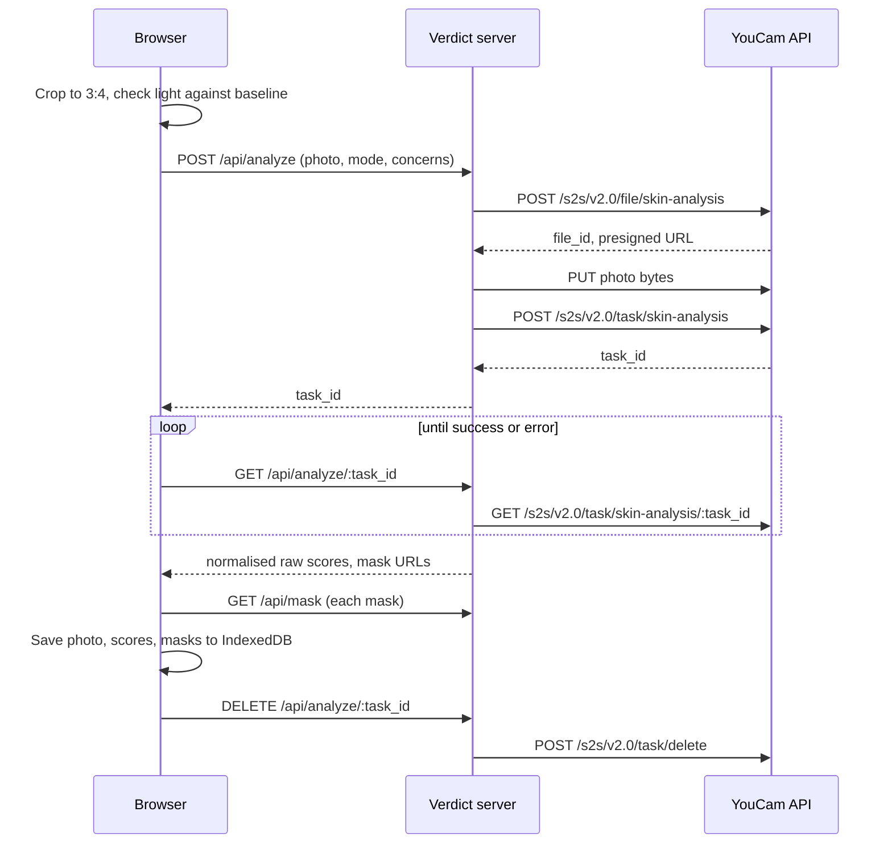
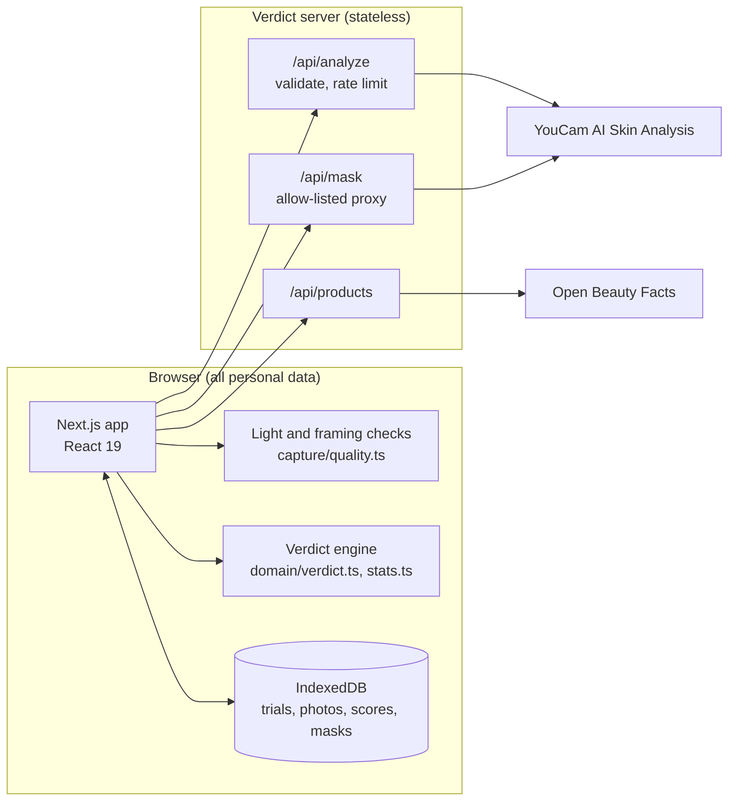

<div align="center">


# Verdict

**Is your skincare working, or are you just hoping?**

A measured, honest trial of one for any skincare product, built on YouCam AI Skin Analysis.<br>
It ends with a decision you can act on at the till: keep buying it, stop, or wait until a named date.

[](https://github.com/opeblow/verdict/actions/workflows/ci.yml)
[](https://github.com/opeblow/verdict/actions/workflows/codeql.yml)
[](LICENSE)
[](package.json)
[](tsconfig.json)
[](tests/)
[](https://yce.perfectcorp.com/ai-api)

<!-- Before submitting, add: [Live demo](https://your-deployment) / [Demo video](https://youtu.be/...) / -->
[For judges](#for-judges) &nbsp;/&nbsp; [How it decides](docs/METHOD.md) &nbsp;/&nbsp; [Setup](SETUP.md) &nbsp;/&nbsp; [Deploy](#deploy)

[](https://vercel.com/new/clone?repository-url=https%3A%2F%2Fgithub.com%2Fopeblow%2Fverdict&env=YOUCAM_API_KEY&envDescription=Your%20YouCam%20API%20key.%20Add%20ACCESS_CODE%20later%20to%20protect%20a%20public%20demo&envLink=https%3A%2F%2Fgithub.com%2Fopeblow%2Fverdict%2Fblob%2Fmain%2FSETUP.md&project-name=verdict&repository-name=verdict)

</div>

---

<p align="center">
  
</p>

## Contents

- [At a glance](#at-a-glance)
- [For judges](#for-judges)
  - [What the judges are looking for, and where Verdict delivers it](#what-the-judges-are-looking-for-and-where-verdict-delivers-it)
  - [What sets Verdict apart](#what-sets-verdict-apart)
  - [Test it in five minutes](#test-it-in-five-minutes)
- [The problem](#the-problem)
- [What Verdict does](#what-verdict-does)
- [YouCam API integration](#youcam-api-integration)
- [How a verdict is computed](#how-a-verdict-is-computed)
- [Architecture](#architecture)
- [Security and privacy](#security-and-privacy)
- [Accessibility and inclusion](#accessibility-and-inclusion)
- [Quickstart](#quickstart)
- [Configuration](#configuration)
- [Deploy](#deploy)
- [API reference](#api-reference)
- [Project structure](#project-structure)
- [Testing and quality gates](#testing-and-quality-gates)
- [Limits](#limits)
- [Roadmap](#roadmap)
- [Documentation](#documentation)
- [Credits and licence](#credits-and-licence)

## At a glance

| | |
|---|---|
| **Who it is for** | Anyone who has bought a skincare product and wondered, weeks later, whether to buy it again |
| **The moment it meets** | The brief's own words: "standing in front of a mirror deciding whether a product is working" |
| **What you get** | Keep, Stop, Wait (with a date), More data, Likely purging, or Don't rebuy, each with the numbers behind it |
| **How YouCam is used** | As a measuring instrument across weeks: the full upload, analyse, poll, mask and delete cycle, HD and SD, up to 8 concerns per call |
| **What makes it trustworthy** | `raw_score` only, a measured personal noise floor, 95% ranges, matched light, and "too early" as a real answer |
| **Privacy** | No accounts and no server database. Photos and scores live on your device. Photos are deleted from YouCam once results are saved. |
| **Engineering** | Next.js 16, React 19, strict TypeScript, about 5,100 lines of app code, 107 tests, CI, CodeQL, strict CSP |
| **Track** | Skin AI |

## For judges

### What the judges are looking for, and where Verdict delivers it

The four criteria are weighted equally. This round also asks for a working web or mobile app with clear value for shoppers or retailers. Every claim below links to the code or document that proves it.

#### 1. Technological implementation

*Judges ask: is the YouCam integration thorough and skilful, and is the code working and non-trivial?*

| What Verdict does | Evidence |
|---|---|
| The full YouCam v2 cycle on the server: register file, presigned `PUT`, create task, poll, collect masks, delete the task | [`src/lib/server/youcam.ts`](src/lib/server/youcam.ts), [`src/lib/client/api.ts`](src/lib/client/api.ts) |
| HD and SD, chosen from the camera at baseline and locked for the trial so incomparable scores are never mixed | [`src/lib/capture/image.ts`](src/lib/capture/image.ts), [`docs/METHOD.md`](docs/METHOD.md) |
| Concern sets padded to the edge of YouCam's billing tier (1-4, 5-8, 9-12, 13-16), so no paid capacity is wasted | [`planConcerns` in `concerns.ts`](src/lib/domain/concerns.ts) |
| `raw_score` used for every calculation, because YouCam documents `ui_score` as adjusted upwards | [`src/lib/youcam/normalize.ts`](src/lib/youcam/normalize.ts) |
| The live engine error format, `"('message', 'error_code')"`, parsed and turned into a plain instruction such as "Move closer" | [`src/lib/youcam/errors.ts`](src/lib/youcam/errors.ts) |
| Detection masks copied to the device before their links expire, then shown on a before-and-after slider | [`src/app/api/mask/route.ts`](src/app/api/mask/route.ts), [`CompareSlider.tsx`](src/components/verdict/CompareSlider.tsx) |
| A dependency-free statistics engine: noise estimation with a cautious prior, least-squares trend, pooled 95% interval | [`src/lib/domain/stats.ts`](src/lib/domain/stats.ts), [`verdict.ts`](src/lib/domain/verdict.ts) |
| 107 unit tests, run in CI with lint, strict typecheck and a production build on every push | [`tests/`](tests/), [`.github/workflows/ci.yml`](.github/workflows/ci.yml) |

#### 2. Design

*Judges ask: is this a complete, coherent product rather than a proof of concept?*

| What Verdict does | Evidence |
|---|---|
| A complete journey: choose product, set goals, two baseline photos, weekly check-ins, dashboard, verdict | [Screenshots](#what-verdict-does), [`src/app/trials/`](src/app/trials) |
| Guided capture: your first photo is overlaid on the camera, with a live readout of brightness, side light, colour temperature, glare and blur | [`CaptureFlow.tsx`](src/components/capture/CaptureFlow.tsx), [`quality.ts`](src/lib/capture/quality.ts) |
| Product search, barcode scanning and manual entry, with ingredients read automatically | [`ProductPicker.tsx`](src/components/product/ProductPicker.tsx) |
| Cost per week and per year next to the verdict, so the answer is about money as well as skin | [`TrialDashboard.tsx`](src/app/trials/[id]/TrialDashboard.tsx) |
| Calendar reminders as a standard `.ics` file, with no push service or account | [`ics.ts`](src/lib/client/ics.ts) |
| A distinctive editorial design system with light and dark themes, phone first | [`globals.css`](src/app/globals.css), [mobile screenshot](docs/screenshots/mobile.png) |

#### 3. Potential impact

*Judges ask: is there a credible case for a real problem and audience, solved as demonstrated?*

| What Verdict does | Evidence |
|---|---|
| Meets a decision every skincare buyer makes, repeatedly: buy it again or not | [The problem](#the-problem) |
| Stops people abandoning good products too early, by giving each active a fair-verdict week (niacinamide on pores: about eight weeks) | [`ingredients.ts`](src/lib/domain/ingredients.ts), 18 actives |
| Catches irritation early: redness is measured on every photo, whatever the product claims, and a rise stops the trial | [`SAFETY_CONCERNS` in `concerns.ts`](src/lib/domain/concerns.ts) |
| Value for shoppers (money not wasted) and for retailers (fewer returns and more confident repeat purchases of products that work) | [Roadmap](#roadmap) |
| Ready to run: one-click deploy, guarded API units, no database to operate | [Deploy](#deploy) |

#### 4. Quality of the idea

*Judges ask: is the use of the API creative and non-obvious, and does it show real understanding of the problem?*

| What Verdict does | Evidence |
|---|---|
| Uses YouCam as a measuring instrument across time. One score is a curiosity; a series with known noise is evidence. | [`docs/METHOD.md`](docs/METHOD.md) |
| Two baseline photos a minute apart measure each person's own noise floor, and every claim of change must clear it | [`stats.ts`](src/lib/domain/stats.ts) |
| Tells a purge from a reaction: blemishes rising early on a retinoid or acid are labelled likely purging; rising redness means stop | [`verdict.ts`](src/lib/domain/verdict.ts), [`tests/verdict.test.ts`](tests/verdict.test.ts) |
| Compares each person only with themselves, in their own light, instead of with population norms that may fit some skin tones poorly | [Accessibility and inclusion](#accessibility-and-inclusion) |

### What sets Verdict apart

The strongest projects from the first round shared four traits. Verdict was built to have all of them.

| Trait | How Verdict shows it |
|---|---|
| **Honesty about AI output** | `raw_score` only, a measured noise floor, 95% ranges, "too early" as a real answer, and the method published inside the app at `/method` |
| **A real, testable product** | Public repository, CI, CodeQL, 107 tests, one-click deploy, and a live smoke test against the real API |
| **Domain understanding beyond the API** | Ingredient timelines, the four-week skin renewal cycle, purging, and photographic measurement practice |
| **Inclusion** | Self-comparison instead of population norms, keyboard access throughout, chart summaries for screen readers |

Most skin apps answer "what is my skin like today?" with one photo. Verdict answers a harder question that a single photo cannot: "has this product changed my skin?"

### Test it in five minutes

**On the live app** (needs a camera and good front light):

1. Open the live app. If asked, enter the access code from the submission form.
2. Choose **Start a trial**, then **Enter by hand**. Paste `Aqua, Niacinamide, Zinc PCA, Glycerin` as the ingredients.
3. Accept the suggested targets. Note the fair-verdict week Verdict sets for each one.
4. Take the two baseline photos. Each takes 10 to 40 seconds to analyse.
5. Open the trial and choose **Check in now** to see the alignment overlay and light matching against your first photo.

A real trial takes weeks, so the landing page shows the real engine's output on a clearly labelled example trial, and the demo video shows completed trials.

**Without a key or camera**, every rule can be checked from the code:

```bash
git clone https://github.com/opeblow/verdict.git && cd verdict
npm install
npm test          # 107 tests, including every verdict rule
```

## The problem

People do not wonder about their skin in the abstract. They wonder in front of the mirror, three weeks into a new serum, deciding whether to buy another bottle. That moment fails them in three ways:

1. **They judge too early.** Retinol, vitamin C and peptides took 8 to 12 weeks to show in their best-known trials. One renewal cycle of the skin's outer layer is about four weeks. Most people decide long before either.
2. **They judge against noise.** The same skin photographed in a brighter room, or under a warmer lamp, looks different. A mirror cannot separate real change from changed light.
3. **They cannot tell a purge from a reaction.** More blemishes in week two of a retinoid is common and expected. Rising redness is a reason to stop. Both feel like "it's not working".

The result is money spent on products that do nothing, good products abandoned too soon, and irritants kept too long.

## What Verdict does

Verdict turns "is this working?" into a small, fair experiment and gives a decision with a reason.

| Step | What happens |
|---|---|
| **1. Name the product** | Search Open Beauty Facts, scan the barcode, or type it in. Verdict reads the ingredient list, finds the actives, and sets a fair-verdict week for each claim. |
| **2. Two baseline photos** | Taken a minute apart. Their difference measures how much your scores move when nothing has changed: your personal noise floor. |
| **3. Weekly check-ins** | Your first photo is overlaid on the camera so you line up the same way. Brightness, side light, colour temperature, glare and blur are measured and compared with the first photo before a new one counts. |
| **4. A verdict** | Keep, stop, wait until a named date, likely purging, or don't rebuy. Every claim of change is larger than your measured noise floor. |

<table>
  <tr>
    <td width="33%"></td>
    <td width="33%"></td>
    <td width="33%"></td>
  </tr>
  <tr>
    <td align="center"><sub><b>Verdict and evidence</b><br>change, 95% range, photo noise, fair-verdict week</sub></td>
    <td align="center"><sub><b>Goals from ingredients</b><br>slowest active sets the deadline</sub></td>
    <td align="center"><sub><b>Matched capture</b><br>light is checked against the first photo</sub></td>
  </tr>
  <tr>
    <td width="33%"></td>
    <td width="33%"></td>
    <td width="33%"></td>
  </tr>
  <tr>
    <td align="center"><sub><b>Purge, not reaction</b><br>blemishes up early, redness flat</sub></td>
    <td align="center"><sub><b>Your trials</b></sub></td>
    <td align="center"><sub><b>Published method</b></sub></td>
  </tr>
  <tr>
    <td width="33%"></td>
    <td width="33%"></td>
    <td width="33%"></td>
  </tr>
  <tr>
    <td align="center"><sub><b>Phone first</b></sub></td>
    <td align="center"><sub><b>Landing on a phone</b></sub></td>
    <td align="center"><sub><b>Dark theme</b></sub></td>
  </tr>
</table>

## YouCam API integration

Verdict uses **YouCam AI Skin Analysis** (Perfect Corp) as its measuring instrument. All calls are made from the server; the API key never reaches the browser.

| Step | Endpoint | Where |
|---|---|---|
| Register upload | `POST /s2s/v2.0/file/skin-analysis` | [`src/lib/server/youcam.ts`](src/lib/server/youcam.ts) |
| Upload bytes | `PUT` to the presigned URL (without the API key) | same |
| Run analysis | `POST /s2s/v2.0/task/skin-analysis` with `format: "json"` and HD or SD `dst_actions` | same |
| Poll | `GET /s2s/v2.0/task/skin-analysis/{task_id}` | [`src/app/api/analyze/[taskId]/route.ts`](src/app/api/analyze/[taskId]/route.ts) |
| Copy masks to device | Result `mask_urls` through an allow-listed proxy | [`src/app/api/mask/route.ts`](src/app/api/mask/route.ts) |
| Delete from YouCam | `POST /s2s/v2.0/task/delete` | [`src/lib/client/api.ts`](src/lib/client/api.ts) |



### Concerns measured

Verdict tracks 12 YouCam concerns. Every score points the same way: higher means healthier looking.

| Group | Concerns |
|---|---|
| Blemishes and tone | acne, redness (always measured, as the irritation monitor), age spots, radiance |
| Texture | pores, texture, wrinkles, firmness |
| Hydration and oil | moisture, oiliness |
| Eye area | dark circles, eye bags |

### Decisions that make the measurement honest

- **`raw_score`, never `ui_score`.** YouCam's documentation states the UI score is adjusted upwards as a motivator. It is the right number to show once and the wrong number to measure change with.
- **One mode per trial.** HD and SD come from different models. A trial locks to the mode of its first photo and refuses a lower-resolution check-in instead of mixing incomparable scores.
- **Billing-tier aware.** YouCam bills by concern count (1-4, 5-8, 9-12, 13-16). Verdict measures the targets plus a redness irritation monitor, then fills the rest of the tier so no paid capacity is wasted ([`planConcerns`](src/lib/domain/concerns.ts)).
- **Framed for the model.** The API needs the face wider than 60% of the image. Every photo is cropped to a centred 3:4 portrait with a face guide sized to 68% of the width, so a laptop webcam and a phone produce the same framing.
- **Live error format handled.** The live API returns engine errors as a stringified tuple, `"('message', 'error_code')"`, not the bare code the reference shows. Both are parsed and mapped to a plain instruction such as "Move closer" ([`errors.ts`](src/lib/youcam/errors.ts)).
- **Masks survive expiry.** Result links expire after about two hours, so detection masks are copied to the device immediately, then the task is deleted from YouCam.

### Unit budget

| Concerns per call | SD units | HD units |
|---|---|---|
| 1-4 | 9 | 12 |
| 5-8 | 12 | 16 |
| 9-12 | 14 | 20 |
| 13-16 | 16 | 22 |

A Verdict analysis measures 4 to 8 concerns. A full eight-week trial (two baseline photos plus eight weekly check-ins) costs about 160 HD units, so 1,000 units covers about six complete trials.

## How a verdict is computed

Full write-up: [docs/METHOD.md](docs/METHOD.md). In short:

1. **Noise floor.** Replicate photos estimate per-photo measurement noise, shrunk towards a cautious prior so two lucky photos cannot create false confidence.
2. **Change.** A least-squares line through every photo since day zero, with a 95% interval that pools the replicate noise and the scatter around the line.
3. **Decision.** Improved or worse only when the whole interval clears zero and the change is at least 3 points. "Don't rebuy" only when a meaningful benefit is confidently ruled out. Before an active's fair-verdict week the answer is "wait", with the date.
4. **Domain rules.** Blemishes rising in the first six weeks of a retinoid or exfoliating acid are labelled likely purging. Redness rising beyond the noise floor stops the trial at any week.

### The possible answers

| Decision | Shown when |
|---|---|
| **Baseline set** | The two baseline photos are in. Nothing to judge yet. |
| **Wait** | It is before the fair-verdict week of the slowest target. The date is shown. |
| **More data** | The fair-verdict week has passed but the 95% range is still too wide to call. |
| **Keep** | A target improved: the whole 95% range is above zero and the change is at least 3 points. |
| **Stop** | Redness rose beyond the noise floor, at any week. This overrides every other result. |
| **Don't rebuy** | A meaningful benefit is confidently ruled out on the targets. |

The engine is pure TypeScript with no dependencies ([`src/lib/domain`](src/lib/domain)) and is covered by unit tests that pin each rule.

## Architecture



| Layer | Runs in | Responsibility |
|---|---|---|
| `src/lib/domain` | Anywhere | Pure rules: concerns, ingredients, statistics, verdicts. No I/O. |
| `src/lib/capture` | Browser | Light and framing checks, photo cropping and sizing |
| `src/lib/client` | Browser | IndexedDB storage, calls to Verdict's own API, calendar export |
| `src/lib/server` | Server only | YouCam client, environment, access code, rate limits |
| `src/lib/youcam` | Both | Response normalisation and error mapping, shared with tests |
| `src/app/api` | Server | Thin, validated route handlers |

## Security and privacy

- **No database, no accounts.** The server holds no personal data and does not log request bodies. Everything lives in the browser and can be exported, imported or erased from [Your data](src/app/settings/DataSettings.tsx).
- **The YouCam key stays on the server.** Only `src/lib/server` reads it. The presigned upload is sent without it, and a test checks this.
- **SSRF allow-list.** The mask proxy only fetches YouCam result hosts ([`isAllowedResultUrl`](src/lib/server/guard.ts)).
- **Strict Content Security Policy** and security headers on every response ([`next.config.ts`](next.config.ts)). The browser only talks to Verdict's own origin.
- **Input validation** with Zod on every route, with size limits on uploads.
- **API units protected.** Optional access code (compared in constant time), per-visitor hourly limits, and a daily cap per server instance.
- **Photos deleted from YouCam** as soon as results are saved on the device.

Threat model and reporting: [SECURITY.md](SECURITY.md). Data flows in plain words: [PRIVACY.md](PRIVACY.md).

## Accessibility and inclusion

- Every interactive element is reachable by keyboard.
- Charts carry an `aria-label` summary, and status changes are announced with `aria-live`.
- Light and dark themes follow the system setting.
- Verdict compares each person only with their own earlier photos, in their own light. It never ranks skin against a population average, which can fit some skin tones poorly.
- Copy is plain, second person and cosmetic only. A test fails the build on medical claims or emoji in user-facing text ([`copy-guard.test.ts`](tests/copy-guard.test.ts)).

## Quickstart

Requires Node 20.9 or newer and a YouCam API key. Full instructions: [SETUP.md](SETUP.md).

```bash
git clone https://github.com/opeblow/verdict.git
cd verdict
npm install
cp .env.example .env.local      # add YOUCAM_API_KEY
npm run dev                      # http://localhost:3000
```

The camera needs a secure context: `localhost` works in development; use HTTPS for a phone.

| Command | Does |
|---|---|
| `npm run dev` | Development server |
| `npm run build` then `npm start` | Production build and server |
| `npm run check` | Lint, typecheck and unit tests, as CI runs them |
| `npm test` | Unit tests only |
| `npm run test:coverage` | Unit tests with a coverage report |
| `npm run smoke:youcam -- photo.jpg sd` | One live analysis against your key, printing the normalised result |
| `npm run screenshots` | Regenerate the images in this README |

## Configuration

All variables are read on the server only. Copy [`.env.example`](.env.example) to `.env.local`.

| Variable | Required | Default | Purpose |
|---|---|---|---|
| `YOUCAM_API_KEY` | yes | | Bearer key for the YouCam API |
| `YOUCAM_API_BASE` | no | `https://yce-api-01.makeupar.com` | API host |
| `YOUCAM_SKIN_VERSION` | no | `v2.0` | `v2.0` or `v2.1` skin analysis engine |
| `ACCESS_CODE` | no | | If set, visitors must enter this code before an analysis runs |
| `RATE_LIMIT_PER_HOUR` | no | `20` | Analyses per visitor per hour |
| `DAILY_ANALYSIS_CAP` | no | `150` | Analyses per server instance per day |

## Deploy

Verdict is a standard Next.js app with no database. Any Node host works.

**Vercel (recommended)**

1. Click **Deploy with Vercel** at the top of this page, or import the repository in Vercel.
2. Add `YOUCAM_API_KEY`. For a public demo, also set `ACCESS_CODE`.
3. Deploy. The default build settings are correct.
4. Open `/api/health` on the deployment. It should show `"youcamConfigured": true`.

**Any Node server**

```bash
npm ci
npm run build
YOUCAM_API_KEY=... npm start   # port 3000, or set PORT
```

Serve it behind HTTPS, because browsers only allow the camera on secure origins.

## API reference

Every error has the shape `{ "error": { "code": "...", "message": "..." } }`.

| Method and path | Purpose | Input | Returns |
|---|---|---|---|
| `GET /api/health` | Is the server ready to analyse? | | `{ ok, youcamConfigured, accessCodeRequired, skinVersion }` |
| `POST /api/analyze` | Start a skin analysis | Multipart: `image` (JPEG or PNG, at most 10 MB), `mode` (`hd` or `sd`), `concerns` (JSON array), `width`, `height` | `{ taskId }` |
| `GET /api/analyze/{taskId}` | Poll a task | | `{ status: "running" }`, the normalised result, or a retake hint |
| `DELETE /api/analyze/{taskId}` | Delete the photo and results from YouCam | | Confirmation |
| `GET /api/mask?u={url}` | Copy a YouCam result image to the device | A YouCam result URL (allow-listed hosts only) | The image |
| `GET /api/products?q={text}` | Search products | 2 to 80 characters | `{ products }` |
| `GET /api/products?barcode={digits}` | Look up a barcode | 6 to 14 digits | `{ products }` |

If `ACCESS_CODE` is set, analysis and mask requests must carry it.

## Project structure

```
verdict/
├── .github/
│   ├── ISSUE_TEMPLATE/
│   │   ├── bug_report.yml               bug report form
│   │   ├── config.yml                   issue chooser and private security contact
│   │   └── feature_request.yml          feature request form
│   ├── workflows/
│   │   ├── ci.yml                       lint, typecheck, tests with coverage, build
│   │   └── codeql.yml                   CodeQL security scanning
│   ├── dependabot.yml                   weekly npm and monthly Actions updates
│   └── pull_request_template.md         checklist for pull requests
│
├── docs/
│   ├── METHOD.md                        measurement protocol and statistics
│   ├── SUBMISSION.md                    Devpost submission draft
│   └── screenshots/                     README images, regenerated by script
│
├── public/
│   ├── icon-192.png                     app icon, 192 px
│   ├── icon-512.png                     app icon, 512 px
│   ├── logo.svg                         Verdict mark
│   └── manifest.webmanifest             installable web app manifest
│
├── scripts/
│   ├── screenshots.mjs                  Playwright: seeds sample data, captures README images
│   └── youcam-smoke.mjs                 one live YouCam analysis to check a key
│
├── src/
│   ├── app/                             Next.js App Router
│   │   ├── api/
│   │   │   ├── analyze/
│   │   │   │   ├── route.ts             POST: validate photo, start a YouCam task
│   │   │   │   └── [taskId]/route.ts    GET: poll a task. DELETE: remove it from YouCam
│   │   │   ├── health/route.ts          is the server configured? (no secrets)
│   │   │   ├── mask/route.ts            allow-listed proxy for YouCam result images
│   │   │   └── products/route.ts        product search and barcode lookup
│   │   ├── method/page.tsx              the method, published in the app
│   │   ├── privacy/page.tsx             where data goes, in plain words
│   │   ├── settings/
│   │   │   ├── DataSettings.tsx         export, import, erase; access code
│   │   │   └── page.tsx
│   │   ├── trials/
│   │   │   ├── new/
│   │   │   │   ├── NewTrialWizard.tsx   product, targets, price, baseline photos
│   │   │   │   ├── page.tsx
│   │   │   │   └── wizard.module.css
│   │   │   ├── [id]/
│   │   │   │   ├── check-in/
│   │   │   │   │   ├── CheckInScreen.tsx    weekly matched-light check-in
│   │   │   │   │   ├── checkin.module.css
│   │   │   │   │   └── page.tsx
│   │   │   │   ├── TrialDashboard.tsx   verdict, trends, cost, compare slider
│   │   │   │   ├── dashboard.module.css
│   │   │   │   └── page.tsx
│   │   │   ├── TrialList.tsx            your trials and next check-in dates
│   │   │   ├── list.module.css
│   │   │   └── page.tsx
│   │   ├── apple-icon.png
│   │   ├── globals.css                  design tokens, light and dark themes
│   │   ├── icon.svg                     favicon
│   │   ├── layout.tsx                   root layout, metadata, site chrome
│   │   ├── page.module.css
│   │   ├── page.tsx                     landing page with a computed example verdict
│   │   └── prose.module.css             long-form page styles
│   │
│   ├── components/
│   │   ├── capture/
│   │   │   ├── CaptureFlow.tsx          camera, face guide, live light checks, upload
│   │   │   └── CaptureFlow.module.css
│   │   ├── product/
│   │   │   ├── ProductPicker.tsx        search, barcode scan, manual entry
│   │   │   └── ProductPicker.module.css
│   │   ├── verdict/
│   │   │   ├── CompareSlider.tsx        before and after, with detection masks
│   │   │   ├── CompareSlider.module.css
│   │   │   ├── TrendChart.tsx           score over time with no-change band
│   │   │   ├── VerdictCard.tsx          the decision and its reason
│   │   │   ├── VerdictCard.module.css
│   │   │   └── labels.tsx               decision and status labels
│   │   ├── Logo.tsx                     mark and wordmark
│   │   ├── SiteChrome.tsx               header and footer
│   │   └── SiteChrome.module.css
│   │
│   └── lib/
│       ├── domain/                      pure logic, no I/O, fully tested
│       │   ├── concerns.ts              12 concerns, YouCam actions, tier planning
│       │   ├── example.ts               labelled example trial for the landing page
│       │   ├── ingredients.ts           18 actives and their fair-verdict weeks
│       │   ├── model.ts                 Trial, Product and CheckIn types
│       │   ├── stats.ts                 noise floor, trend, 95% interval
│       │   └── verdict.ts               decision rules, purging, irritation stop
│       ├── youcam/                      shared by server and tests
│       │   ├── errors.ts                engine error parsing and plain-language fixes
│       │   └── normalize.ts             raw scores and masks from task output
│       ├── server/                      server only
│       │   ├── env.ts                   reads and validates environment variables
│       │   ├── guard.ts                 access code, SSRF allow-list, JSON errors
│       │   ├── openBeautyFacts.ts       product data client
│       │   ├── rateLimit.ts             sliding-window limits
│       │   ├── upstream.ts              maps YouCam failures to responses
│       │   └── youcam.ts                YouCam v2 client: file, task, poll, delete
│       ├── capture/
│       │   ├── image.ts                 3:4 crop and HD or SD sizing (browser)
│       │   └── quality.ts               brightness, side light, glare, blur (pure)
│       └── client/                      browser only
│           ├── api.ts                   upload, poll, collect masks, delete
│           ├── checkins.ts              store a finished capture
│           ├── db.ts                    IndexedDB: trials, photos, scores, masks
│           ├── ics.ts                   calendar reminders (RFC 5545)
│           └── useTrial.ts              React hooks for trial state
│
├── tests/
│   ├── fixtures/youcam.ts               responses in the official OpenAPI shapes
│   ├── copy-guard.test.ts               no medical claims, no emoji
│   ├── domain.test.ts                   concerns, ingredients, capture checks
│   ├── server.test.ts                   SSRF guard, access code, rate limits, env
│   ├── stats.test.ts                    noise, trend and interval maths
│   ├── verdict.test.ts                  every decision rule
│   └── youcam.test.ts                   client call sequence, errors, normalisation
│
├── .editorconfig
├── .env.example                         environment template
├── .gitignore
├── .nvmrc                               Node version
├── AGENTS.md                            rules for AI coding agents
├── CODE_OF_CONDUCT.md
├── CONTRIBUTING.md
├── LICENSE                              MIT
├── PLANS.md                             research, decisions, roadmap
├── PRIVACY.md
├── README.md
├── SECURITY.md
├── SETUP.md                             install, configure, deploy
├── eslint.config.mjs
├── next.config.ts                       CSP and security headers
├── package.json
├── tsconfig.json                        strict, with unchecked index access
└── vitest.config.mts
```

## Testing and quality gates

```bash
npm run check     # lint + typecheck + 107 tests
npm run build     # production build
```

| Suite | Covers |
|---|---|
| [`stats.test.ts`](tests/stats.test.ts) | Noise estimation, the cautious prior, trend lines and 95% intervals |
| [`verdict.test.ts`](tests/verdict.test.ts) | Every decision: wait, more data, keep, stop, don't rebuy, likely purging |
| [`youcam.test.ts`](tests/youcam.test.ts) | The client's call sequence, the key never sent with the upload, HD and SD normalisation, live error parsing |
| [`server.test.ts`](tests/server.test.ts) | SSRF allow-list, constant-time access code check, rate limits, environment parsing, product data mapping |
| [`domain.test.ts`](tests/domain.test.ts) | Concern planning by billing tier, ingredient detection, light measurement, calendar export |
| [`copy-guard.test.ts`](tests/copy-guard.test.ts) | Fails the build on medical claims or emoji in user-facing text |

CI runs all of this, plus a production build, on every push and pull request. CodeQL scans the code weekly and on every pull request.

## Limits

Verdict measures how skin looks in photos. It is not a medical device and does not diagnose or treat any condition. A trial of one cannot rule out other causes, such as weather, sleep, or a second new product, so the app asks you to change one thing at a time. Analysis models can be less reliable for some skin tones and in low light; matching your own conditions week to week reduces this but does not remove it.

## Roadmap

- **Split-face trials:** product on one side only, compared using the detection masks.
- **YouCam Skin Tone Analysis** as an independent light-matching check.
- **An MCP tool interface** so an assistant can run check-ins in conversation.
- **For retailers:** opt-in, anonymised "how often does this product earn a Keep" on product pages.

## Documentation

| Document | Contents |
|---|---|
| [SETUP.md](SETUP.md) | Install, configure, deploy, troubleshoot |
| [docs/METHOD.md](docs/METHOD.md) | The measurement protocol and statistics |
| [PLANS.md](PLANS.md) | Research, product decisions and roadmap |
| [SECURITY.md](SECURITY.md) | Threat model and how to report a vulnerability |
| [PRIVACY.md](PRIVACY.md) | Where data goes |
| [CONTRIBUTING.md](CONTRIBUTING.md) | How to contribute |
| [AGENTS.md](AGENTS.md) | Guide for AI coding agents working in this repo |
| [CODE_OF_CONDUCT.md](CODE_OF_CONDUCT.md) | Community standards |

## Credits and licence

Skin measurement by [YouCam AI Skin Analysis](https://yce.perfectcorp.com/ai-api) from Perfect Corp, used under the YouCam API terms of service. Product data from [Open Beauty Facts](https://world.openbeautyfacts.org), available under the Open Database License. Typefaces Newsreader and IBM Plex, under the SIL Open Font License.

Verdict is released under the [MIT License](LICENSE).
