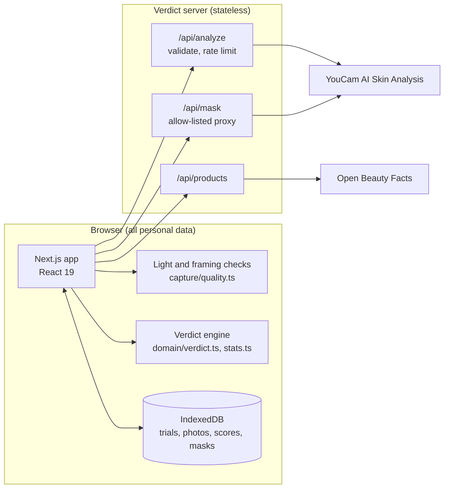
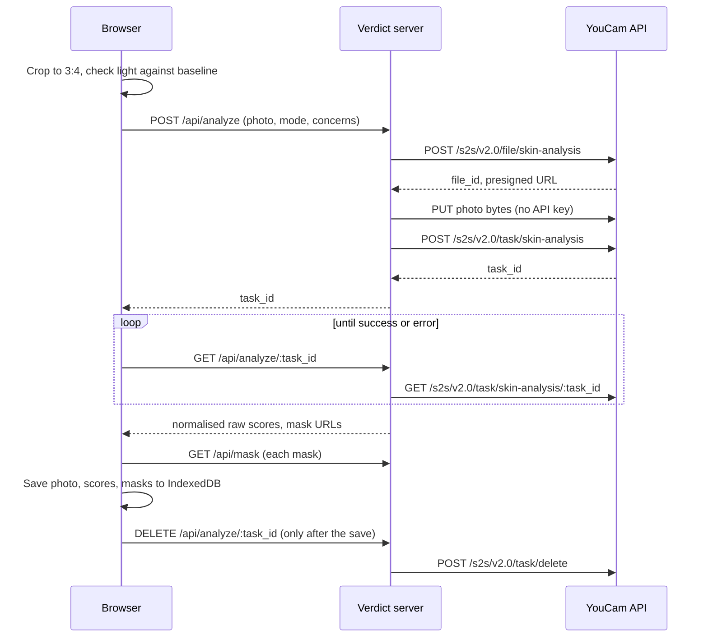

# Architecture

Verdict is one Next.js 16 app. Everything personal stays in the browser. The server is a thin, stateless proxy that holds the YouCam key. The reasons behind each choice are recorded in [adr/](adr/README.md).

## System



## Layers

Dependencies point one way: UI, then client and capture code, then the pure domain. Server code is reachable only through the route handlers.

| Layer | Runs in | Responsibility | Rule |
|---|---|---|---|
| [`src/lib/domain`](../src/lib/domain) | Anywhere | Concerns, ingredients, statistics, verdicts | Pure functions only. No I/O, no React, `now` passed in ([ADR 0005](adr/0005-pure-domain-layer.md)) |
| [`src/lib/capture`](../src/lib/capture) | Browser | Light and framing checks, crop and sizing | `quality.ts` stays pure and tested |
| [`src/lib/client`](../src/lib/client) | Browser | IndexedDB, calls to Verdict's own API, calendar export | Never imports server code |
| [`src/lib/youcam`](../src/lib/youcam) | Both | Response normalisation and error mapping | Tolerates missing fields |
| [`src/lib/server`](../src/lib/server) | Server only | YouCam client, environment, access code, rate limits | The only code that reads the key ([ADR 0001](adr/0001-device-only-data-stateless-server.md)) |
| [`src/app/api`](../src/app/api) | Server | Thin, validated route handlers | Validate input; errors as `{ error: { code, message } }` |
| [`src/app`](../src/app), [`src/components`](../src/components) | Browser | Pages and UI | CSS Modules and the tokens in `globals.css` |

## One analysis, end to end



If the save fails, the result stays in memory and the user can retry the save without a new analysis ([ADR 0006](adr/0006-delete-from-youcam-after-local-save.md)).

## Data model

Defined in [`src/lib/domain/model.ts`](../src/lib/domain/model.ts) and stored in two IndexedDB object stores ([`db.ts`](../src/lib/client/db.ts)).

| Store | Key | Index | Holds |
|---|---|---|---|
| `trials` | `id` | `byCreated` | Product, price, actives, targets, concern set, locked mode, photo protocol, status |
| `checkins` | `id` | `byTrial` | Kind (baseline or check-in), session, raw and UI scores per metric, light conditions, the photo and detection masks as blobs |

## Repository layout

```
verdict/
├── .github/                  CI, CodeQL, Dependabot, issue and pull request templates
├── docs/                     everything beyond the README (start at docs/README.md)
│   ├── adr/                  architecture decision records
│   └── screenshots/          README images, regenerated by script
├── public/                   icons and web app manifest
├── scripts/
│   ├── screenshots.mjs       seeds sample trials, captures README images (no API calls)
│   └── youcam-smoke.mjs      one live analysis to check a key before a demo
├── src/
│   ├── app/                  Next.js App Router pages and API routes
│   │   ├── api/
│   │   │   ├── analyze/      POST: start a task. [taskId]: GET poll, DELETE remove from YouCam
│   │   │   ├── health/       is the server configured? (no secrets)
│   │   │   ├── mask/         allow-listed proxy for YouCam result images
│   │   │   └── products/     product search and barcode lookup
│   │   ├── trials/
│   │   │   ├── new/          four-step wizard: product, goals, setup, baseline photos
│   │   │   └── [id]/         dashboard; check-in/ for weekly photos
│   │   ├── method/           the method, published in the app
│   │   ├── privacy/          where data goes, in plain words
│   │   └── settings/         export, import, erase; access code
│   ├── components/
│   │   ├── capture/          camera, face guide, live light checks, upload and save
│   │   ├── product/          search, barcode scan, manual entry
│   │   └── verdict/          verdict card, trend chart, compare slider, labels
│   └── lib/
│       ├── domain/           concerns, ingredients, stats, verdict rules (pure)
│       ├── capture/          quality.ts (pure) and image.ts (browser)
│       ├── client/           IndexedDB, API calls, hooks, calendar export
│       ├── server/           YouCam client, env, guards, rate limits
│       └── youcam/           normalisation and error mapping
├── tests/
│   ├── unit/                 Vitest: domain, statistics, verdicts, YouCam client, server guards, copy guard
│   ├── e2e/                  Playwright: full journey, save retry, capture quality, API guards, accessibility
│   └── fixtures/             YouCam responses in the official OpenAPI shapes
├── AGENTS.md                 rules and invariants for contributors and coding agents
├── CONTRIBUTING.md
├── CODE_OF_CONDUCT.md
├── SECURITY.md               threat model and reporting
├── playwright.config.ts      browser tests: production build, YouCam mocked
├── vitest.config.mts         unit tests and coverage
└── next.config.ts            Content Security Policy and security headers
```
